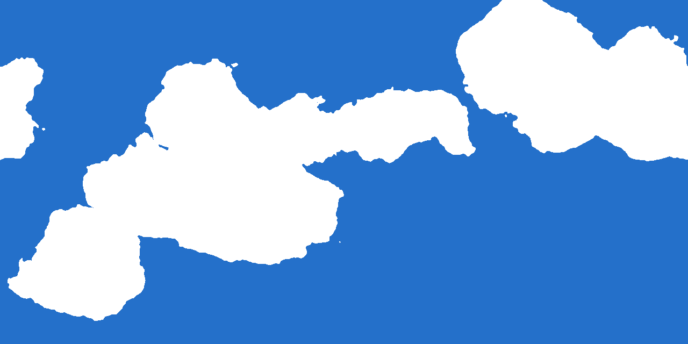

# Aurelia Utils

Telegram-бот на Python 3.12 и aiogram 3. Делает обычные контурные карты: белая суша `#FFFFFF`, синяя вода `#2470CA`

В этой версии 2 режима: генерация по seed и по пятну суши. Все управление находится в личном чате Telegram. Нужны только сообщения, кнопки и загрузка картинки



## Что работает

- Генерация по слову или числу. Настраиваются доля суши, количество материковых ядер, изрезанность и размер
- Пятно из PNG, JPEG, WEBP или BMP. Выбор светлой или темной суши, порог яркости, предпросмотр маски. Прозрачный фон считается водой
- Точный режим пятна. Каждый пиксель классифицированной маски сохраняется при размере 1:1, включая острова и озера размером в 1 px
- Увеличение пятна через Nearest Neighbor с сохранением пропорций. Уменьшение запрещено
- Отдельный режим "Живой берег". Он меняет очертания в полосе у воды. Его выбирает пользователь, по умолчанию включен точный режим
- Размеры 2К, 4К, 8К, 16К и свои размеры. Максимум 134 217 728 px, сторона до 16 384 px, соотношение сторон от 1:4 до 4:1
- PNG полного размера, уменьшенный предпросмотр и ZIP с PNG, параметрами и оригиналом пятна
- Сохраненные работы, пагинация, подтверждение удаления, отмена задачи, восстановление очереди после перезапуска
- Постепенное появление длинной справки через `sendMessageDraft`. При недоступности метода используется `editMessageText`. Анимация отключается. Простые действия выполняются сразу
- Реальные стадии обработки и счетчик готовых строк. Проценты по таймеру не используются

Количество материковых ядер не равно точному количеству островов и материков: массивы могут соединяться или распадаться. Доля суши относится к пикселям карты, не к площади планеты

## Быстрый запуск через Docker Compose

```bash
git clone https://github.com/janmann782-bot/Aurelia-Utils.git
cd Aurelia-Utils
cp .env.example .env
```

Впиши в `.env` токен из `@BotFather`

```dotenv
BOT_TOKEN=твой_токен
```

Запусти оба процесса

```bash
docker compose up -d --build
docker compose logs -f bot worker
```

Открой бота в Telegram и отправь `/start`. Команда `/cancel` отменяет активную задачу. Отмена тяжелой операции применяется на ближайшей контрольной точке

Токен нужен только процессу бота. Worker не получает его. Порты не публикуются. Обычный long polling требует исходящего HTTPS к Telegram. Если у токена остался webhook от другого приложения, сначала отключи его. Одновременно запускать старый и новый экземпляры бота с 1 токеном нельзя

## Запуск без Docker

Linux, Python 3.12+

```bash
python -m venv .venv
source .venv/bin/activate
pip install -r requirements.txt
cp .env.example .env
```

Заполни `.env`. В 2 терминалах с активным окружением запусти

```bash
python -m aurelia_utils.worker
```

```bash
python -m aurelia_utils.bot
```

После запуска база создается автоматически. Скрипты не требуют платного ИИ или стороннего сервиса генерации

## Как сделать карту

**По seed:** `/start` -> "По seed" -> слово, число или случайный seed -> параметры -> "Сделать карту". Нажми "PNG" под результатом

**По пятну:** `/start` -> "По пятну" -> отправь залитые континенты документом -> "Открыть пятно" -> выбери что считать сушей -> проверь маску и параметры -> "Сделать карту"

Лучше отправлять PNG документом. Фотографии Telegram сжимает и меняет их пиксели. Бот предупреждает об этом. В точном режиме сохраняется геометрия выбранной маски, а цвет результата всегда бело-синий. Это не импорт политической карты со всеми исходными цветами

Нужна заливка на контрастном фоне. Контурная линия автоматически не заполняется. Надписи, рамки и другие детали исходника тоже могут попасть в маску. Бот показывает оба варианта распознавания. Порог можно поменять и повторно проверить

Для полного сохранения мелких объектов используй исходный размер или целочисленное увеличение. При дробном увеличении применяется Nearest Neighbor, толщина отдельных деталей может меняться. Файл оригинала остается неизменным

"Живой берег" строит поле расстояний от берега и добавляет шум с заданным seed. Отклонение ограничено 2,4 % ширины рабочей сетки. Это приблизительное сохранение пятна. Мелкие острова могут измениться. Точный режим не использует этот алгоритм

## Хранение и ограничения

Данные находятся в `DATA_DIR`, в Docker это именованный том `aurelia_data`

```text
data/
  aurelia.sqlite3
  users/<telegram_user_id>/<job_id>/
    source             # Оригинальные байты пятна, если есть
    map.png
    preview.png
    metadata.json
    project.zip
```

SQLite с WAL хранит параметры, настройки, состояния меню и очередь. Файлы отделены по владельцу. Каждая кнопка чтения и удаления проверяет владельца. Отдельный процесс worker обрабатывает по 1 задаче. Блокировка запрещает запуск 2 worker на одном каталоге

Для этого объема функций PostgreSQL и Redis не нужны. Эта сборка рассчитана на 1 VPS и общий локальный диск, не на кластер. Не размещай SQLite на сетевой файловой системе

По умолчанию: 1 активная задача на пользователя, 50 задач в общей очереди, 50 готовых работ на пользователя, 256 МБ файлов на пользователя и 2 048 МБ на сервер. Исходники пятна тоже считаются работами. Лимиты хранения и таймаут меняются в `.env`. Ошибочные и отмененные работы доступны для удаления. Исходник нельзя удалить пока на него ссылаются сохраненные карты

Входящий файл ограничен 20 МБ и 33 554 432 px, например 8 192 x 4 096. Это сознательный предел для стандартного облачного Telegram Bot API и VPS. 16К поддерживается как размер результата. Входной файл 16К здесь не поддерживается

Содержимое файла проверяется Pillow. Анимированные и неподдерживаемые форматы отклоняются. Имя файла не используется как путь. Загрузка ограничена по фактическим байтам. Экспорт больше 49 МБ не отправляется через обычный Bot API. Для сложного исходника выбери меньший допустимый результат

Worker пишет PNG полосами по 64 строки через zlib и атомарно заменяет готовый файл. Большая RGB-копия результата в памяти не создается. Рабочее поле генерации ограничено стороной 2 048 px. У 16К больше выходных пикселей, но не в 8 раз больше мелких географических деталей. Пятно в точном режиме обрабатывается в исходном разрешении. Декодирование загруженного растра Pillow все равно требует память под исходник

Том Docker переживает пересоздание контейнеров. `docker compose down` сохраняет его. **`docker compose down -v` удалит данные**

## Резервная копия и восстановление

Автосохранение происходит после каждого завершенного действия. Активные задачи после сбоя выполняются заново с теми же параметрами. Уведомление о результате доставляется повторно после запуска бота. Возможен повтор сообщения если процесс упал ровно после отправки в Telegram и до записи признака доставки. Готовые карты не дублируются

Резервные копии запускаются администратором. Скрипт не устанавливает расписание сам

Для локального запуска останови оба процесса. Затем

```bash
python -m scripts.backup /backups/aurelia-backup.zip
```

Для Docker, где данные хранятся в именованном томе

```bash
docker compose stop bot worker
docker compose run --rm --no-deps --user root --entrypoint tar worker -C /app/data -czf - . > aurelia-data-backup.tar.gz
docker compose up -d
```

Для восстановления останови оба контейнера и распакуй копию в тот же том

```bash
docker compose stop bot worker
docker compose run --rm --no-deps -T --user root --entrypoint tar worker -C /app/data -xzf - < aurelia-data-backup.tar.gz
docker compose run --rm --no-deps --user root --entrypoint chown worker -R 10001:10001 /app/data
docker compose up -d
```

Копия содержит ID пользователей и оригиналы карт. Храни ее в закрытом месте

## Проверка

```bash
pip install pytest
python -m pytest -q
python -m scripts.demo
python -m scripts.benchmark 8192 4096
python -m scripts.benchmark 16384 8192
```

Тесты проверяют воспроизводимость по seed, цвета, долю суши, стык долгот, пиксельную геометрию пятна, прозрачность, однопиксельные острова и озера, ограничения файлов, обработку 8К, отмену, сохранения, изоляцию владельцев, восстановление очереди и Telegram-меню через тестовую сессию aiogram

Замеры движка в среде разработки, Python 3.12, 1 процесс

| Размер | Время | Пиковая память RSS |
| --- | --- | --- |
| 8 192 x 4 096 | 5,83 с | 198,4 МБ |
| 16 384 x 8 192 | 11,13 с | 198,4 МБ |

Это время генерации и сохранения PNG, без очереди и передачи через Telegram. Скорость на VPS зависит от процессора. Для старта разумно 2 ГБ RAM и 2 vCPU. В Compose worker ограничен 1 ГБ памяти

**Проверка в живом Telegram требует токена. Он не включен в проект. Docker-сборка требует установленного Docker.** Не выдавай офлайн-тесты за проверку доставки файлов настоящему пользователю

## Структура

- `aurelia_utils/bot.py` - меню, ввод, загрузки, экспорт и уведомления
- `aurelia_utils/engine.py` - география, маски и потоковый PNG
- `aurelia_utils/store.py` - SQLite, состояния и очередь
- `aurelia_utils/worker.py` - тяжелые операции, квоты, сохранение результатов
- `tests/` - автоматические проверки
- `scripts/` - примеры, замеры и резервная копия
- `examples/` - готовые примеры

## Что пока не реализовано

Политические границы, государства, редактор территорий, Undo/Redo, флаги, генератор названий, палитры, проекции, геодезические площади, рельеф, реки, физические карты, надписи HOI, GeoJSON и SVG. Здесь только генератор контурной карты в согласованном объеме. В меню нет кнопок несуществующих функций

Тексты кнопок и подсказок короткие и разговорные. Указанный автором Pismo v8.1 SLED HUMOR+ учтен для подачи. Частный файл с его содержимым не включен в публичный репозиторий

## Документация используемых API

- [aiogram: long polling](https://docs.aiogram.dev/en/latest/dispatcher/long_polling.html)
- [Telegram: sendMessageDraft](https://core.telegram.org/bots/api#sendmessagedraft)
- [Telegram: getFile](https://core.telegram.org/bots/api#getfile)
- [Telegram: sendDocument](https://core.telegram.org/bots/api#senddocument)
